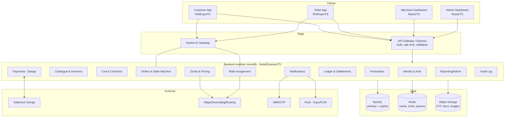

# 02 — System Architecture & Monorepo Proposal

> Status: DRAFT for review.

## 1. Architectural style

A **modular monolith backend** behind a single API gateway process, organized into clear
domain modules, with multiple frontends. We deliberately do **not** start with
microservices: at launch volume, a well-modularized monolith is cheaper to operate, easier
to keep transactionally correct (money + orders in one database with real transactions), and
faster to evolve. Module boundaries are drawn so individual domains (e.g. payments,
assignment) can later be extracted into services if scale demands.

**Rationale (challenged assumption):** Microservices would fragment the financial
transaction boundary and multiply failure modes (distributed transactions, saga
complexity) for no launch-stage benefit. Revisit only when a domain has independent scaling
or team-ownership pressure.

## 2. Component map



## 3. Backend module responsibilities

| Module | Owns | Must not |
|--------|------|----------|
| **Identity & Auth** | Users, roles, sessions, OTP, token issuance | Make pricing/order decisions |
| **Catalogue & Inventory** | Merchants, categories, products, options, stock | Trust client prices |
| **Cart & Checkout** | Cart assembly, server-side pricing snapshot | Persist money as floats |
| **Orders** | Order aggregate + state machine, transitions | Mutate ledger directly |
| **Zones & Pricing** | Delivery zones, fee rules, distance pricing | Expose internal cost basis to customers |
| **Rider Assignment** | Online riders, offers, accept/decline, conflicts | Bypass order state guards |
| **Payments** | Daraja STK, callbacks, timeouts, idempotency | Mark orders paid without verified callback |
| **Ledger & Settlements** | Double-entry ledger, settlements, payouts | Be written outside a DB transaction |
| **Promotions** | Promo definitions, eligibility, redemption caps | Produce negative totals |
| **Notifications** | Push/SMS fan-out, templating | Hold business state |
| **Reporting/Admin** | Read models, config, overrides | Skip audit logging |
| **Audit** | Append-only security/money event log | Be mutable/deletable |

Modules communicate **in-process via typed service interfaces** and emit **domain events**
(e.g. `order.paid`, `rider.assigned`) on an internal event bus. The bus is backed by Redis
Streams / an outbox table so it can be swapped for a real broker later without changing
call sites.

## 4. Real-time (Socket.IO) — where it is justified

Socket.IO is used **only** where polling is inadequate:
- Customer: live order status + rider location.
- Rider: incoming job offers, assignment acceptance race resolution.
- Merchant: new-order alerts.

Everything else uses plain REST. Socket.IO rooms are keyed by resource (`order:{id}`,
`rider:{id}`, `merchant:{id}`) and **authorized on connect and on room-join** using the same
RBAC as REST. Socket events never carry authoritative money/state; they notify, and clients
re-fetch canonical state from REST when it matters.

## 5. Monorepo layout

Tooling: **pnpm workspaces + Turborepo** for task orchestration and caching; shared TS
config and ESLint/Prettier at the root. (npm/yarn workspaces are acceptable fallbacks — see
open decisions.)

```
BojDeliveryPlatform/
├─ apps/
│  ├─ api/                 # Express + TS backend (modular monolith)
│  ├─ customer-mobile/     # Expo RN + TS
│  ├─ rider-mobile/        # Expo RN + TS
│  ├─ merchant-web/        # React + TS (Vite)
│  └─ admin-web/           # React + TS (Vite)
├─ packages/
│  ├─ shared-types/        # DTOs, enums, zod schemas shared client↔server
│  ├─ api-client/          # Generated/typed client from OpenAPI
│  ├─ validation/          # Zod schemas reused at the server boundary
│  ├─ money/               # Integer-minor-unit money utilities (KES)
│  ├─ config/              # Env schema + loader (zod-validated)
│  └─ ui/                  # Shared web UI primitives (optional)
├─ db/
│  ├─ migrations/          # Versioned SQL migrations (source of truth)
│  └─ seeds/               # Synthetic/dev seed data only
├─ docs/
│  ├─ architecture/        # <- this documentation
│  └─ openapi/             # openapi.yaml + generated html
├─ infra/                  # IaC, docker-compose, deployment manifests
├─ .github/workflows/      # CI pipelines
├─ turbo.json
├─ pnpm-workspace.yaml
└─ package.json
```

**Key boundary rule:** `apps/*` never import each other. Cross-cutting contracts live in
`packages/*`. The backend owns business logic; UI apps consume typed DTOs and never
re-implement pricing, permissions, or state rules.

## 6. Backend internal layout (`apps/api`)

```
apps/api/src/
├─ modules/
│  ├─ identity/            # controller, service, repo, policies
│  ├─ catalogue/
│  ├─ cart/
│  ├─ orders/
│  ├─ pricing/
│  ├─ assignment/
│  ├─ payments/
│  ├─ ledger/
│  ├─ promotions/
│  ├─ notifications/
│  ├─ reporting/
│  └─ audit/
├─ platform/
│  ├─ http/                # Express app, middleware, error handling
│  ├─ db/                  # connection pool, transaction helper, uow
│  ├─ events/              # internal event bus + outbox
│  ├─ realtime/            # Socket.IO server + room auth
│  ├─ security/            # authn, rbac, rate limiting
│  └─ observability/       # logging, metrics, request-id
└─ main.ts
```

Each module exposes a thin **controller** (HTTP/validation only) → **service** (business
logic, transaction boundaries) → **repository** (SQL). Business logic lives in services, per
CLAUDE.md ("keep business logic out of UI components" — enforced by making UI unable to
reach it).

## 7. Technology choices (with reasons)

| Concern | Choice | Reason |
|---------|--------|--------|
| Language | TypeScript everywhere | Single language, shared types, CLAUDE.md rule |
| HTTP | Express | Mandated; mature, simple |
| Validation | Zod at the boundary | Runtime validation + inferred types; shared pkg |
| DB access | **Knex** (query builder + migrations) | First-class transactions, `SELECT … FOR UPDATE`, raw SQL, spatial types; **decided — see ADR-0001** |
| Migrations | Plain versioned SQL (Knex migrate or node-pg-migrate style) | SQL is the contract; reviewable; CLAUDE.md requires documented migrations |
| Cache/locks/queues | Redis | Distributed locks (assignment), rate limits, ephemeral offers |
| Realtime | Socket.IO | Mandated; fits offer/tracking |
| Jobs | BullMQ (Redis) | Reconciliation, payout batches, timeouts |
| Auth tokens | JWT access + rotating refresh | Stateless API tier; refresh revocation via store |
| Object storage | S3-compatible | KYC docs, product images, delivery proof |
| Maps | Google Maps **or** Mapbox | Distance matrix + geocoding; **see open decision** |
| Push | Expo Push (→ FCM/APNs) | Native to Expo apps |

**ORM/query decision — RESOLVED (ADR-0001): Knex.** We need first-class transactions and
pessimistic locking for money and stock, hand-authored reviewed SQL migrations, and MySQL
spatial types. Knex gives raw control over all three; Prisma's generated migrations and raw
escape-hatches for `FOR UPDATE`/`GEOMETRY` were a poorer fit. See
`decisions/0001-data-access-knex-over-prisma.md`.

## 8. Environments

`local` (docker-compose: MySQL, Redis, MinIO, mock-daraja) → `staging` (sandbox Daraja,
real maps quota) → `production`. Config via `packages/config` with a zod-validated env
schema; missing/invalid env fails fast at boot.

## 9. Future-proofing hooks

- **Multi-town:** every zone/merchant/order carries a `town_id`; pricing and assignment are
  parameterized by town.
- **Multi-merchant basket:** order is modeled as `order` → `order_merchant` → `order_item`
  even though launch enforces exactly one merchant (a CHECK/application guard), so relaxing
  it later is additive.
- **Service extraction:** modules already talk through interfaces + events, so payments or
  assignment can be lifted into a service with an outbox-driven integration.

## 10. Acceptance criteria

- [ ] Monorepo bootstraps with `pnpm install` and a single `turbo run build/lint/test`.
- [ ] `apps/api` boots with zod-validated config and fails fast on bad env.
- [ ] Module boundaries enforced by lint rule (no cross-app imports).
- [ ] Socket.IO connections rejected without a valid token and room authorization.
