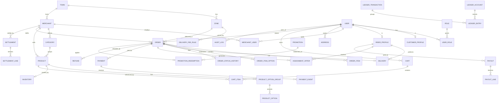

# 03 — Data Model: ERD & MySQL Schema

> Status: DRAFT for review. SQL is illustrative DDL to anchor review; final column types and
> indexes will be tuned against query patterns during Phase 1.

## 1. Money & numeric conventions (non-negotiable)

- **All monetary amounts are stored as `BIGINT` cents (KES minor units).** No `FLOAT`/`DOUBLE`
  for money, ever. A `packages/money` helper is the only sanctioned way to do arithmetic.
- Currency column (`char(3)` default `'KES'`) is present for future-proofing but fixed at launch.
- Quantities are integers; weights/distances (if needed) use `DECIMAL(10,3)`.
- Timestamps are `DATETIME(3)` in **UTC**; the app layer localizes to `Africa/Nairobi`.
- Primary keys: `BIGINT UNSIGNED AUTO_INCREMENT` internally, plus a public **`uuid`/ULID**
  column for external references (never expose auto-increment IDs in APIs).
- Engine: **InnoDB** (transactions, row locks, FKs). Charset `utf8mb4`.

## 2. Entity relationship diagram



## 3. Core tables (illustrative DDL)

### 3.1 Identity & roles

```sql
CREATE TABLE user (
  id            BIGINT UNSIGNED PRIMARY KEY AUTO_INCREMENT,
  ulid          CHAR(26) NOT NULL UNIQUE,
  phone_e164    VARCHAR(20) NOT NULL UNIQUE,      -- +2547XXXXXXXX
  email         VARCHAR(255) NULL UNIQUE,
  display_name  VARCHAR(120) NULL,
  password_hash VARCHAR(255) NULL,                -- null if OTP-only
  status        ENUM('active','suspended','deleted') NOT NULL DEFAULT 'active',
  created_at    DATETIME(3) NOT NULL DEFAULT CURRENT_TIMESTAMP(3),
  updated_at    DATETIME(3) NOT NULL DEFAULT CURRENT_TIMESTAMP(3) ON UPDATE CURRENT_TIMESTAMP(3)
) ENGINE=InnoDB;

CREATE TABLE role (
  id    SMALLINT UNSIGNED PRIMARY KEY AUTO_INCREMENT,
  code  VARCHAR(40) NOT NULL UNIQUE   -- customer, rider, merchant_owner, merchant_staff, admin, finance, ops
);

CREATE TABLE user_role (
  user_id BIGINT UNSIGNED NOT NULL,
  role_id SMALLINT UNSIGNED NOT NULL,
  PRIMARY KEY (user_id, role_id),
  FOREIGN KEY (user_id) REFERENCES user(id),
  FOREIGN KEY (role_id) REFERENCES role(id)
) ENGINE=InnoDB;

CREATE TABLE auth_credential_otp (
  id          BIGINT UNSIGNED PRIMARY KEY AUTO_INCREMENT,
  phone_e164  VARCHAR(20) NOT NULL,
  code_hash   VARCHAR(255) NOT NULL,
  purpose     ENUM('login','verify') NOT NULL,
  attempts    TINYINT UNSIGNED NOT NULL DEFAULT 0,
  expires_at  DATETIME(3) NOT NULL,
  consumed_at DATETIME(3) NULL,
  created_at  DATETIME(3) NOT NULL DEFAULT CURRENT_TIMESTAMP(3),
  INDEX (phone_e164, purpose)
) ENGINE=InnoDB;

CREATE TABLE refresh_token (
  id          BIGINT UNSIGNED PRIMARY KEY AUTO_INCREMENT,
  user_id     BIGINT UNSIGNED NOT NULL,
  token_hash  VARCHAR(255) NOT NULL UNIQUE,
  family_id   CHAR(26) NOT NULL,            -- rotation family for reuse detection
  expires_at  DATETIME(3) NOT NULL,
  revoked_at  DATETIME(3) NULL,
  created_at  DATETIME(3) NOT NULL DEFAULT CURRENT_TIMESTAMP(3),
  FOREIGN KEY (user_id) REFERENCES user(id),
  INDEX (user_id)
) ENGINE=InnoDB;
```

### 3.2 Merchants, catalogue, inventory

```sql
CREATE TABLE town (
  id       BIGINT UNSIGNED PRIMARY KEY AUTO_INCREMENT,
  ulid     CHAR(26) NOT NULL UNIQUE,       -- public identifier
  name     VARCHAR(120) NOT NULL,
  timezone VARCHAR(60) NOT NULL DEFAULT 'Africa/Nairobi',
  is_active TINYINT(1) NOT NULL DEFAULT 1
) ENGINE=InnoDB;

-- A zone is a CIRCLE serviceable area (centre + radius), not a GEOMETRY polygon. Decided for the
-- single compact Migori CBD launch (D1 / ADR referenced in decision-log): simpler, unit-testable
-- without MySQL spatial, boundaries still config-driven. `center_*`/`radius_m` are nullable while a
-- zone is being configured and are required (by the service) before it can be activated / resolved.
-- A GEOMETRY polygon model remains a documented future enhancement for precise multi-zone boundaries.
CREATE TABLE zone (
  id         BIGINT UNSIGNED PRIMARY KEY AUTO_INCREMENT,
  ulid       CHAR(26) NOT NULL UNIQUE,     -- public identifier
  town_id    BIGINT UNSIGNED NOT NULL,
  name       VARCHAR(120) NOT NULL,
  center_lat DECIMAL(9,6) NULL,
  center_lng DECIMAL(9,6) NULL,
  radius_m   INT UNSIGNED NULL,            -- serviceable radius from the centre, metres
  is_active  TINYINT(1) NOT NULL DEFAULT 1,
  FOREIGN KEY (town_id) REFERENCES town(id)
) ENGINE=InnoDB;

CREATE TABLE merchant (
  id            BIGINT UNSIGNED PRIMARY KEY AUTO_INCREMENT,
  ulid          CHAR(26) NOT NULL UNIQUE,
  town_id       BIGINT UNSIGNED NOT NULL,
  name          VARCHAR(160) NOT NULL,
  category_type ENUM('restaurant','grocery','pharmacy','retail','other') NOT NULL,
  status        ENUM('pending','approved','suspended','closed') NOT NULL DEFAULT 'pending',
  is_open       TINYINT(1) NOT NULL DEFAULT 0,
  prep_minutes  SMALLINT UNSIGNED NOT NULL DEFAULT 20,
  commission_bps INT UNSIGNED NOT NULL,          -- basis points, server-controlled
  lat           DECIMAL(9,6) NULL,
  lng           DECIMAL(9,6) NULL,
  created_at    DATETIME(3) NOT NULL DEFAULT CURRENT_TIMESTAMP(3),
  FOREIGN KEY (town_id) REFERENCES town(id)
) ENGINE=InnoDB;

CREATE TABLE merchant_user (
  merchant_id BIGINT UNSIGNED NOT NULL,
  user_id     BIGINT UNSIGNED NOT NULL,
  role        ENUM('owner','staff') NOT NULL,
  PRIMARY KEY (merchant_id, user_id),
  FOREIGN KEY (merchant_id) REFERENCES merchant(id),
  FOREIGN KEY (user_id) REFERENCES user(id)
) ENGINE=InnoDB;

CREATE TABLE category (
  id          BIGINT UNSIGNED PRIMARY KEY AUTO_INCREMENT,
  merchant_id BIGINT UNSIGNED NOT NULL,
  name        VARCHAR(120) NOT NULL,
  sort_order  INT NOT NULL DEFAULT 0,
  is_active   TINYINT(1) NOT NULL DEFAULT 1,
  FOREIGN KEY (merchant_id) REFERENCES merchant(id),
  INDEX (merchant_id)
) ENGINE=InnoDB;

CREATE TABLE product (
  id            BIGINT UNSIGNED PRIMARY KEY AUTO_INCREMENT,
  ulid          CHAR(26) NOT NULL UNIQUE,
  merchant_id   BIGINT UNSIGNED NOT NULL,
  category_id   BIGINT UNSIGNED NULL,
  name          VARCHAR(160) NOT NULL,
  description   TEXT NULL,
  price_cents   BIGINT NOT NULL,              -- authoritative base price
  currency      CHAR(3) NOT NULL DEFAULT 'KES',
  is_available  TINYINT(1) NOT NULL DEFAULT 1,
  version       INT UNSIGNED NOT NULL DEFAULT 1,  -- optimistic lock for price edits
  created_at    DATETIME(3) NOT NULL DEFAULT CURRENT_TIMESTAMP(3),
  FOREIGN KEY (merchant_id) REFERENCES merchant(id),
  FOREIGN KEY (category_id) REFERENCES category(id),
  INDEX (merchant_id, is_available)
) ENGINE=InnoDB;

CREATE TABLE product_option_group (
  id          BIGINT UNSIGNED PRIMARY KEY AUTO_INCREMENT,
  product_id  BIGINT UNSIGNED NOT NULL,
  name        VARCHAR(120) NOT NULL,       -- e.g. "Size"
  min_select  TINYINT UNSIGNED NOT NULL DEFAULT 0,
  max_select  TINYINT UNSIGNED NOT NULL DEFAULT 1,
  FOREIGN KEY (product_id) REFERENCES product(id)
) ENGINE=InnoDB;

CREATE TABLE product_option (
  id                 BIGINT UNSIGNED PRIMARY KEY AUTO_INCREMENT,
  option_group_id    BIGINT UNSIGNED NOT NULL,
  name               VARCHAR(120) NOT NULL,
  price_delta_cents  BIGINT NOT NULL DEFAULT 0,
  is_available       TINYINT(1) NOT NULL DEFAULT 1,
  FOREIGN KEY (option_group_id) REFERENCES product_option_group(id)
) ENGINE=InnoDB;

-- Inventory separated so stock updates don't contend with catalogue reads.
CREATE TABLE inventory (
  product_id   BIGINT UNSIGNED PRIMARY KEY,
  track_stock  TINYINT(1) NOT NULL DEFAULT 0,
  quantity     INT NOT NULL DEFAULT 0,        -- current on-hand
  reserved     INT NOT NULL DEFAULT 0,        -- held by in-flight orders
  version      INT UNSIGNED NOT NULL DEFAULT 1,
  updated_at   DATETIME(3) NOT NULL DEFAULT CURRENT_TIMESTAMP(3) ON UPDATE CURRENT_TIMESTAMP(3),
  FOREIGN KEY (product_id) REFERENCES product(id)
) ENGINE=InnoDB;
```

### 3.3 Addresses, zones, delivery fees

```sql
CREATE TABLE address (
  id         BIGINT UNSIGNED PRIMARY KEY AUTO_INCREMENT,
  ulid       CHAR(26) NOT NULL UNIQUE,        -- public identifier
  user_id    BIGINT UNSIGNED NOT NULL,
  label      VARCHAR(60) NULL,
  line1      VARCHAR(200) NOT NULL,
  lat        DECIMAL(9,6) NOT NULL,
  lng        DECIMAL(9,6) NOT NULL,
  zone_id    BIGINT UNSIGNED NULL,            -- resolved at save/checkout
  created_at DATETIME(3) NOT NULL DEFAULT CURRENT_TIMESTAMP(3),
  FOREIGN KEY (user_id) REFERENCES user(id),
  FOREIGN KEY (zone_id) REFERENCES zone(id)
) ENGINE=InnoDB;

CREATE TABLE delivery_fee_rule (
  id              BIGINT UNSIGNED PRIMARY KEY AUTO_INCREMENT,
  ulid            CHAR(26) NOT NULL UNIQUE,       -- public identifier
  zone_id         BIGINT UNSIGNED NOT NULL,
  base_fee_cents  BIGINT NOT NULL,
  per_km_cents    BIGINT NOT NULL DEFAULT 0,
  min_fee_cents   BIGINT NOT NULL,
  max_fee_cents   BIGINT NULL,                    -- NULL = uncapped
  effective_from  DATETIME(3) NOT NULL,
  effective_to    DATETIME(3) NULL,               -- NULL = open-ended
  created_at      DATETIME(3) NOT NULL DEFAULT CURRENT_TIMESTAMP(3),
  FOREIGN KEY (zone_id) REFERENCES zone(id),
  INDEX (zone_id, effective_from)
) ENGINE=InnoDB;

-- Fee = clamp(base_fee_cents + round(per_km_cents × distance_km), min_fee_cents, max_fee_cents).
-- Distance is straight-line (haversine) at launch (D11). The rule in force at an instant is the
-- latest effective_from whose window covers it. Shipped in migration 0009 (Phase 3 Inc 2).
```

### 3.4 Cart

```sql
CREATE TABLE cart (
  id          BIGINT UNSIGNED PRIMARY KEY AUTO_INCREMENT,
  user_id     BIGINT UNSIGNED NOT NULL,
  merchant_id BIGINT UNSIGNED NULL,           -- single-merchant invariant (set by 1st item, cleared when empty)
  created_at  DATETIME(3) NOT NULL DEFAULT CURRENT_TIMESTAMP(3),
  updated_at  DATETIME(3) NOT NULL DEFAULT CURRENT_TIMESTAMP(3) ON UPDATE CURRENT_TIMESTAMP(3),
  UNIQUE (user_id),                           -- one active cart per user at launch
  FOREIGN KEY (user_id) REFERENCES user(id),
  FOREIGN KEY (merchant_id) REFERENCES merchant(id)
) ENGINE=InnoDB;

CREATE TABLE cart_item (
  id          BIGINT UNSIGNED PRIMARY KEY AUTO_INCREMENT,
  ulid        CHAR(26) NOT NULL UNIQUE,       -- public identifier (clients address a line by ulid)
  cart_id     BIGINT UNSIGNED NOT NULL,
  product_id  BIGINT UNSIGNED NOT NULL,
  quantity    INT UNSIGNED NOT NULL,
  options_json JSON NULL,                     -- selected option ULIDs (validated server-side)
  FOREIGN KEY (cart_id) REFERENCES cart(id) ON DELETE CASCADE,
  FOREIGN KEY (product_id) REFERENCES product(id)
) ENGINE=InnoDB;
```

> Cart holds **references only**; prices are never trusted from the cart. The authoritative
> price is snapshotted into the order at checkout time.

### 3.5 Orders (price snapshot + history)

```sql
CREATE TABLE `order` (
  id                BIGINT UNSIGNED PRIMARY KEY AUTO_INCREMENT,
  ulid              CHAR(26) NOT NULL UNIQUE,
  order_number      VARCHAR(20) NOT NULL UNIQUE,   -- human-facing
  customer_id       BIGINT UNSIGNED NOT NULL,
  merchant_id       BIGINT UNSIGNED NOT NULL,
  town_id           BIGINT UNSIGNED NOT NULL,
  zone_id           BIGINT UNSIGNED NOT NULL,
  delivery_address_id BIGINT UNSIGNED NOT NULL,
  status            VARCHAR(40) NOT NULL,          -- see state machine doc
  -- money snapshot (authoritative, server-computed)
  subtotal_cents        BIGINT NOT NULL,
  delivery_fee_cents    BIGINT NOT NULL,
  service_fee_cents     BIGINT NOT NULL DEFAULT 0,
  discount_cents        BIGINT NOT NULL DEFAULT 0,
  total_cents           BIGINT NOT NULL,
  commission_bps        INT UNSIGNED NOT NULL,     -- snapshot of merchant rate
  commission_cents      BIGINT NOT NULL DEFAULT 0,
  currency              CHAR(3) NOT NULL DEFAULT 'KES',
  payment_status        ENUM('unpaid','pending','paid','failed','refunded','partially_refunded') NOT NULL DEFAULT 'unpaid',
  placed_at         DATETIME(3) NULL,
  cancelled_reason  VARCHAR(255) NULL,
  distance_m        INT UNSIGNED NULL,
  created_at        DATETIME(3) NOT NULL DEFAULT CURRENT_TIMESTAMP(3),
  updated_at        DATETIME(3) NOT NULL DEFAULT CURRENT_TIMESTAMP(3) ON UPDATE CURRENT_TIMESTAMP(3),
  FOREIGN KEY (customer_id) REFERENCES user(id),
  FOREIGN KEY (merchant_id) REFERENCES merchant(id),
  FOREIGN KEY (zone_id) REFERENCES zone(id),
  INDEX (customer_id, created_at),
  INDEX (merchant_id, status),
  INDEX (status, created_at)
) ENGINE=InnoDB;

CREATE TABLE order_item (
  id             BIGINT UNSIGNED PRIMARY KEY AUTO_INCREMENT,
  order_id       BIGINT UNSIGNED NOT NULL,
  product_id     BIGINT UNSIGNED NOT NULL,
  name_snapshot  VARCHAR(160) NOT NULL,       -- name at purchase time
  unit_price_cents BIGINT NOT NULL,           -- snapshot
  quantity       INT UNSIGNED NOT NULL,
  line_total_cents BIGINT NOT NULL,
  FOREIGN KEY (order_id) REFERENCES `order`(id) ON DELETE CASCADE,
  FOREIGN KEY (product_id) REFERENCES product(id),
  INDEX (order_id)
) ENGINE=InnoDB;

CREATE TABLE order_item_option (
  id              BIGINT UNSIGNED PRIMARY KEY AUTO_INCREMENT,
  order_item_id   BIGINT UNSIGNED NOT NULL,
  name_snapshot   VARCHAR(120) NOT NULL,
  price_delta_cents BIGINT NOT NULL,
  FOREIGN KEY (order_item_id) REFERENCES order_item(id) ON DELETE CASCADE
) ENGINE=InnoDB;

CREATE TABLE order_status_history (
  id          BIGINT UNSIGNED PRIMARY KEY AUTO_INCREMENT,
  order_id    BIGINT UNSIGNED NOT NULL,
  from_status VARCHAR(40) NULL,
  to_status   VARCHAR(40) NOT NULL,
  actor_type  ENUM('customer','merchant','rider','admin','system') NOT NULL,
  actor_user_id BIGINT UNSIGNED NULL,
  reason      VARCHAR(255) NULL,
  created_at  DATETIME(3) NOT NULL DEFAULT CURRENT_TIMESTAMP(3),
  FOREIGN KEY (order_id) REFERENCES `order`(id),
  INDEX (order_id, created_at)
) ENGINE=InnoDB;
```

### 3.6 Riders, assignment, delivery

```sql
CREATE TABLE rider_profile (
  user_id       BIGINT UNSIGNED PRIMARY KEY,
  status        ENUM('pending','approved','suspended') NOT NULL DEFAULT 'pending',
  vehicle_type  ENUM('motorbike','bicycle','car','foot') NOT NULL,
  is_online     TINYINT(1) NOT NULL DEFAULT 0,
  last_lat      DECIMAL(9,6) NULL,
  last_lng      DECIMAL(9,6) NULL,
  last_ping_at  DATETIME(3) NULL,
  rating_avg    DECIMAL(3,2) NULL,
  FOREIGN KEY (user_id) REFERENCES user(id)
) ENGINE=InnoDB;

CREATE TABLE assignment_offer (
  id          BIGINT UNSIGNED PRIMARY KEY AUTO_INCREMENT,
  order_id    BIGINT UNSIGNED NOT NULL,
  rider_id    BIGINT UNSIGNED NOT NULL,       -- rider_profile.user_id
  status      ENUM('offered','accepted','declined','expired','superseded') NOT NULL DEFAULT 'offered',
  offered_at  DATETIME(3) NOT NULL DEFAULT CURRENT_TIMESTAMP(3),
  responded_at DATETIME(3) NULL,
  expires_at  DATETIME(3) NOT NULL,
  FOREIGN KEY (order_id) REFERENCES `order`(id),
  FOREIGN KEY (rider_id) REFERENCES rider_profile(user_id),
  INDEX (order_id, status),
  INDEX (rider_id, status)
) ENGINE=InnoDB;

CREATE TABLE delivery (
  id              BIGINT UNSIGNED PRIMARY KEY AUTO_INCREMENT,
  order_id        BIGINT UNSIGNED NOT NULL UNIQUE,  -- one delivery per order at launch
  rider_id        BIGINT UNSIGNED NULL,
  status          ENUM('unassigned','assigned','picked_up','delivered','failed') NOT NULL DEFAULT 'unassigned',
  rider_fee_cents BIGINT NOT NULL DEFAULT 0,        -- earnings snapshot
  pickup_confirmed_at   DATETIME(3) NULL,
  delivered_at    DATETIME(3) NULL,
  proof_type      ENUM('pin','otp','photo','signature','none') NOT NULL DEFAULT 'none', -- 'pin' = default method (D7); hashed PIN, never plaintext
  proof_ref       VARCHAR(255) NULL,
  FOREIGN KEY (order_id) REFERENCES `order`(id),
  FOREIGN KEY (rider_id) REFERENCES rider_profile(user_id)
) ENGINE=InnoDB;
```

### 3.7 Payments (M-Pesa) + idempotent events

```sql
CREATE TABLE payment (
  id                 BIGINT UNSIGNED PRIMARY KEY AUTO_INCREMENT,
  ulid               CHAR(26) NOT NULL UNIQUE,
  order_id           BIGINT UNSIGNED NOT NULL,
  method             ENUM('mpesa_stk','cash','simulated') NOT NULL,
  amount_cents       BIGINT NOT NULL,
  currency           CHAR(3) NOT NULL DEFAULT 'KES',
  status             ENUM('initiated','pending','succeeded','failed','timed_out','reversed') NOT NULL DEFAULT 'initiated',
  -- Daraja correlation
  merchant_request_id  VARCHAR(64) NULL,
  checkout_request_id  VARCHAR(64) NULL UNIQUE,   -- STK correlation id
  mpesa_receipt        VARCHAR(32) NULL UNIQUE,   -- unique receipt prevents double-credit
  idempotency_key      VARCHAR(80) NOT NULL UNIQUE, -- client-provided, guards re-initiation
  initiated_at       DATETIME(3) NOT NULL DEFAULT CURRENT_TIMESTAMP(3),
  settled_at         DATETIME(3) NULL,
  FOREIGN KEY (order_id) REFERENCES `order`(id),
  INDEX (order_id, status)
) ENGINE=InnoDB;

-- Append-only record of every raw callback/query result; makes duplicates safe & auditable.
CREATE TABLE payment_event (
  id            BIGINT UNSIGNED PRIMARY KEY AUTO_INCREMENT,
  payment_id    BIGINT UNSIGNED NULL,
  source        ENUM('stk_callback','status_query','reconciliation','manual') NOT NULL,
  dedupe_key    VARCHAR(120) NOT NULL UNIQUE,   -- e.g. checkout_request_id + result_code
  result_code   INT NULL,
  raw_payload   JSON NOT NULL,
  received_at   DATETIME(3) NOT NULL DEFAULT CURRENT_TIMESTAMP(3),
  FOREIGN KEY (payment_id) REFERENCES payment(id),
  INDEX (payment_id)
) ENGINE=InnoDB;

CREATE TABLE refund (
  id            BIGINT UNSIGNED PRIMARY KEY AUTO_INCREMENT,
  ulid          CHAR(26) NOT NULL UNIQUE,
  order_id      BIGINT UNSIGNED NOT NULL,
  payment_id    BIGINT UNSIGNED NOT NULL,
  amount_cents  BIGINT NOT NULL,
  reason        VARCHAR(255) NOT NULL,
  status        ENUM('requested','approved','processing','completed','failed','rejected') NOT NULL DEFAULT 'requested',
  requested_by  BIGINT UNSIGNED NOT NULL,
  approved_by   BIGINT UNSIGNED NULL,
  idempotency_key VARCHAR(80) NOT NULL UNIQUE,
  created_at    DATETIME(3) NOT NULL DEFAULT CURRENT_TIMESTAMP(3),
  FOREIGN KEY (order_id) REFERENCES `order`(id),
  FOREIGN KEY (payment_id) REFERENCES payment(id)
) ENGINE=InnoDB;
```

### 3.8 Ledger, settlements, payouts (double-entry)

```sql
-- Chart of accounts: platform cash, merchant payable, rider payable, commission revenue,
-- promo expense, refunds payable, M-Pesa clearing, etc.
CREATE TABLE ledger_account (
  id    BIGINT UNSIGNED PRIMARY KEY AUTO_INCREMENT,
  code  VARCHAR(40) NOT NULL UNIQUE,
  type  ENUM('asset','liability','revenue','expense') NOT NULL,
  owner_type ENUM('platform','merchant','rider') NOT NULL DEFAULT 'platform',
  owner_id   BIGINT UNSIGNED NULL
) ENGINE=InnoDB;

CREATE TABLE ledger_transaction (
  id          BIGINT UNSIGNED PRIMARY KEY AUTO_INCREMENT,
  ulid        CHAR(26) NOT NULL UNIQUE,
  kind        VARCHAR(40) NOT NULL,      -- order_capture, refund, settlement, payout, adjustment
  ref_type    VARCHAR(40) NOT NULL,      -- order/payment/refund/settlement/payout
  ref_id      BIGINT UNSIGNED NOT NULL,
  idempotency_key VARCHAR(120) NOT NULL UNIQUE,
  created_at  DATETIME(3) NOT NULL DEFAULT CURRENT_TIMESTAMP(3)
) ENGINE=InnoDB;

CREATE TABLE ledger_entry (
  id             BIGINT UNSIGNED PRIMARY KEY AUTO_INCREMENT,
  transaction_id BIGINT UNSIGNED NOT NULL,
  account_id     BIGINT UNSIGNED NOT NULL,
  direction      ENUM('debit','credit') NOT NULL,
  amount_cents   BIGINT NOT NULL CHECK (amount_cents > 0),
  FOREIGN KEY (transaction_id) REFERENCES ledger_transaction(id),
  FOREIGN KEY (account_id) REFERENCES ledger_account(id),
  INDEX (account_id),
  INDEX (transaction_id)
) ENGINE=InnoDB;
-- Invariant (enforced in app + verified by job): sum(debits) = sum(credits) per transaction.

CREATE TABLE settlement (
  id            BIGINT UNSIGNED PRIMARY KEY AUTO_INCREMENT,
  merchant_id   BIGINT UNSIGNED NOT NULL,
  period_start  DATE NOT NULL,
  period_end    DATE NOT NULL,
  gross_cents   BIGINT NOT NULL,
  commission_cents BIGINT NOT NULL,
  refunds_cents BIGINT NOT NULL DEFAULT 0,
  net_cents     BIGINT NOT NULL,
  status        ENUM('draft','approved','paid','failed') NOT NULL DEFAULT 'draft',
  approved_by   BIGINT UNSIGNED NULL,
  created_at    DATETIME(3) NOT NULL DEFAULT CURRENT_TIMESTAMP(3),
  FOREIGN KEY (merchant_id) REFERENCES merchant(id),
  UNIQUE (merchant_id, period_start, period_end)
) ENGINE=InnoDB;

CREATE TABLE settlement_line (
  id            BIGINT UNSIGNED PRIMARY KEY AUTO_INCREMENT,
  settlement_id BIGINT UNSIGNED NOT NULL,
  order_id      BIGINT UNSIGNED NOT NULL,
  gross_cents   BIGINT NOT NULL,
  commission_cents BIGINT NOT NULL,
  net_cents     BIGINT NOT NULL,
  FOREIGN KEY (settlement_id) REFERENCES settlement(id),
  FOREIGN KEY (order_id) REFERENCES `order`(id)
) ENGINE=InnoDB;

CREATE TABLE payout (
  id          BIGINT UNSIGNED PRIMARY KEY AUTO_INCREMENT,
  payee_type  ENUM('merchant','rider') NOT NULL,
  payee_id    BIGINT UNSIGNED NOT NULL,
  amount_cents BIGINT NOT NULL,
  status      ENUM('draft','approved','processing','paid','failed') NOT NULL DEFAULT 'draft',
  method      ENUM('mpesa_b2c','bank','manual') NOT NULL DEFAULT 'manual',
  external_ref VARCHAR(80) NULL,
  idempotency_key VARCHAR(120) NOT NULL UNIQUE,
  approved_by BIGINT UNSIGNED NULL,
  created_at  DATETIME(3) NOT NULL DEFAULT CURRENT_TIMESTAMP(3)
) ENGINE=InnoDB;

CREATE TABLE payout_line (
  id         BIGINT UNSIGNED PRIMARY KEY AUTO_INCREMENT,
  payout_id  BIGINT UNSIGNED NOT NULL,
  ref_type   VARCHAR(40) NOT NULL,     -- settlement / delivery
  ref_id     BIGINT UNSIGNED NOT NULL,
  amount_cents BIGINT NOT NULL,
  FOREIGN KEY (payout_id) REFERENCES payout(id)
) ENGINE=InnoDB;
```

### 3.9 Promotions

```sql
CREATE TABLE promotion (
  id            BIGINT UNSIGNED PRIMARY KEY AUTO_INCREMENT,
  code          VARCHAR(40) NOT NULL UNIQUE,
  type          ENUM('percentage','fixed','free_delivery') NOT NULL,
  value_bps     INT UNSIGNED NULL,          -- for percentage
  value_cents   BIGINT NULL,                -- for fixed
  max_discount_cents BIGINT NULL,           -- cap
  min_subtotal_cents BIGINT NOT NULL DEFAULT 0,
  per_user_limit INT UNSIGNED NOT NULL DEFAULT 1,
  total_limit   INT UNSIGNED NULL,
  total_redeemed INT UNSIGNED NOT NULL DEFAULT 0,
  starts_at     DATETIME(3) NOT NULL,
  ends_at       DATETIME(3) NOT NULL,
  is_active     TINYINT(1) NOT NULL DEFAULT 1
) ENGINE=InnoDB;

CREATE TABLE promotion_redemption (
  id           BIGINT UNSIGNED PRIMARY KEY AUTO_INCREMENT,
  promotion_id BIGINT UNSIGNED NOT NULL,
  user_id      BIGINT UNSIGNED NOT NULL,
  order_id     BIGINT UNSIGNED NOT NULL UNIQUE,  -- one promo per order at launch
  discount_cents BIGINT NOT NULL,
  created_at   DATETIME(3) NOT NULL DEFAULT CURRENT_TIMESTAMP(3),
  FOREIGN KEY (promotion_id) REFERENCES promotion(id),
  UNIQUE (promotion_id, user_id, order_id)
) ENGINE=InnoDB;
```

### 3.10 Audit log (append-only)

```sql
CREATE TABLE audit_log (
  id          BIGINT UNSIGNED PRIMARY KEY AUTO_INCREMENT,
  actor_user_id BIGINT UNSIGNED NULL,
  actor_role  VARCHAR(40) NULL,
  action      VARCHAR(80) NOT NULL,       -- e.g. order.refund.approve
  entity_type VARCHAR(40) NOT NULL,
  entity_id   BIGINT UNSIGNED NULL,
  ip          VARBINARY(16) NULL,
  before_json JSON NULL,
  after_json  JSON NULL,
  created_at  DATETIME(3) NOT NULL DEFAULT CURRENT_TIMESTAMP(3),
  INDEX (entity_type, entity_id),
  INDEX (actor_user_id, created_at)
) ENGINE=InnoDB;
-- Write path only; no UPDATE/DELETE grants for app role.
```

## 4. Concurrency & integrity rules

### 4.1 Stock under concurrent orders
- Stock uses a **reserve-on-checkout, commit-on-fulfilment, release-on-cancel** model.
- Reservation is done inside the checkout transaction with either:
  - optimistic: `UPDATE inventory SET reserved = reserved + :q, version = version + 1
    WHERE product_id = :id AND track_stock = 1 AND (quantity - reserved) >= :q AND version = :v`
    (retry on 0 rows affected), **or**
  - pessimistic: `SELECT … FOR UPDATE` on the inventory row.
- Default: **optimistic with bounded retry**; fall back to `FOR UPDATE` for hot products.

### 4.2 Price correctness
- Checkout recomputes every line from `product.price_cents` + option deltas **server-side**
  and snapshots into `order_item`. The cart's contents are references only.
- Product price edits bump `product.version`; carts referencing a changed price are
  re-priced at checkout and the customer is shown the new total before payment.

### 4.3 Order state
- `order.status` transitions go through the application state machine (doc 04) inside a
  transaction that also writes `order_status_history`. Illegal transitions are rejected.

### 4.4 Money
- Every money movement is a `ledger_transaction` with balanced `ledger_entry` rows, written
  in the **same DB transaction** as the triggering business change, keyed by an
  `idempotency_key` so retries/duplicates are no-ops.

### 4.5 Idempotency & duplicates
- `payment.idempotency_key`, `payment.checkout_request_id`, `payment.mpesa_receipt`,
  `payment_event.dedupe_key`, `refund.idempotency_key`, `ledger_transaction.idempotency_key`,
  and `payout.idempotency_key` are all **UNIQUE**, turning duplicate callbacks/requests into
  safe no-ops at the database layer.

## 5. Indexing & performance notes

- Hot read paths: merchant catalogue (`product(merchant_id, is_available)`), customer order
  list (`order(customer_id, created_at)`), merchant order queue (`order(merchant_id, status)`),
  ops dashboard (`order(status, created_at)`).
- Spatial index on `zone.boundary` for point-in-polygon zone resolution.
- Consider summary/read-model tables for reporting to avoid heavy scans on the OLTP tables.

## 6. Acceptance criteria

- [ ] Schema created via versioned migrations; `down` migrations verified.
- [ ] Seed script loads synthetic town, zones, merchants, products, riders.
- [ ] Concurrency test: N parallel checkouts on 1-stock product → exactly one succeeds.
- [ ] Ledger balance check job reports zero imbalance on seed data.
- [ ] No monetary column is a float anywhere in the schema.
