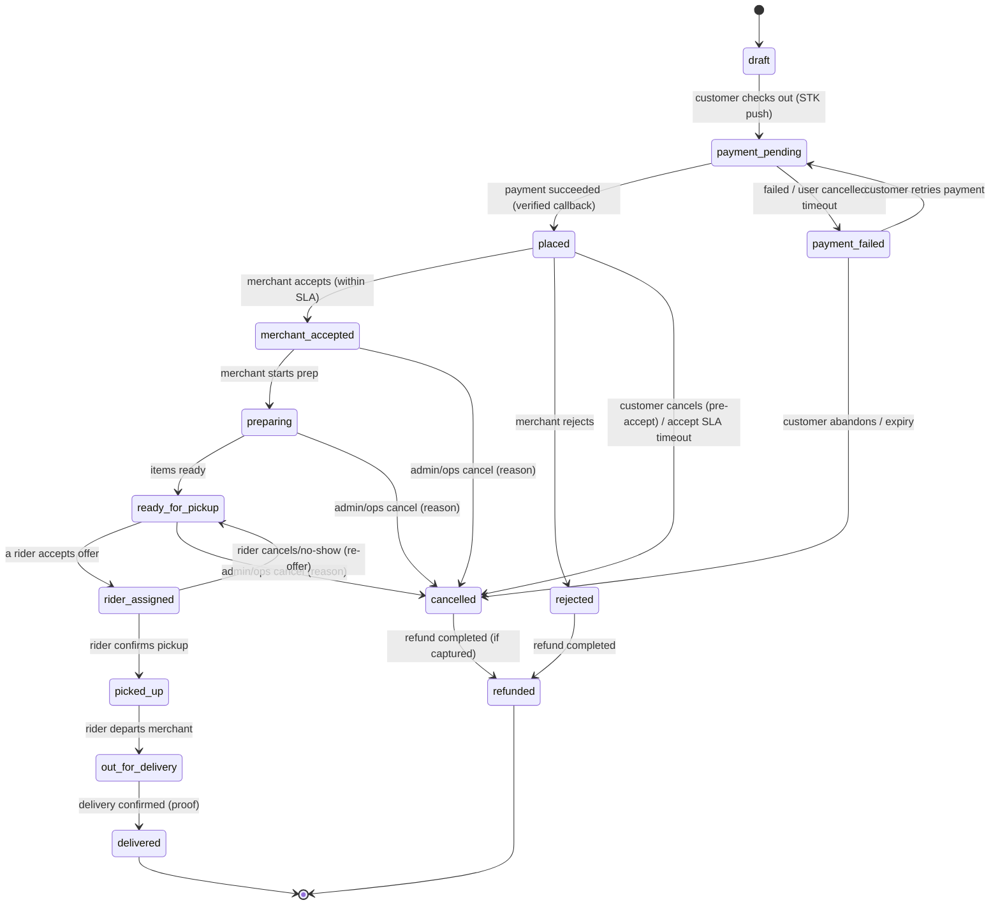

# 04 — Order State Machine

> Status: DRAFT for review. This is the authoritative contract for order lifecycle. The
> implementation must reject any transition not listed here, inside a DB transaction, and
> record it in `order_status_history`.

## 1. Design rules

- **Two coordinated concerns:** `order.status` (fulfilment lifecycle) and `order.payment_status`
  (money). They are related but tracked separately so payment retries don't corrupt
  fulfilment, and vice-versa. Delivery has its own sub-status (`delivery.status`).
- **Every transition** is: guard check → persist new status → append history → emit domain
  event → notify. All in one transaction.
- **Only allowed actors** can trigger each transition (see table). Admin can force
  transitions but every forced move is audited with a reason.
- **Timeouts are system transitions** driven by scheduled jobs, not client calls.

## 2. Primary order states

| State | Meaning | Money implication |
|-------|---------|-------------------|
| `draft` | Cart converted, not yet paid-for / confirmed | none |
| `payment_pending` | STK push sent, awaiting callback | authorization in flight |
| `payment_failed` | Payment failed/timed out | none captured |
| `placed` | Payment confirmed; awaiting merchant accept | captured, held |
| `merchant_accepted` | Merchant accepted; preparing queued | captured |
| `preparing` | Merchant preparing items | captured |
| `ready_for_pickup` | Ready; rider assignment sought | captured |
| `rider_assigned` | Rider accepted the job | captured |
| `picked_up` | Rider collected from merchant | captured |
| `out_for_delivery` | En route to customer | captured |
| `delivered` | Delivered & confirmed | eligible for settlement |
| `cancelled` | Terminated before delivery | refund per policy |
| `rejected` | Merchant declined | full refund |
| `refunded` | Fully refunded (terminal money state) | reversed |

> **Payment-first vs. accept-first (challenged assumption).** This design collects payment
> **before** merchant acceptance (`payment_pending → placed → merchant_accepted`). That means
> a rejected/expired order requires a refund. The alternative (accept-first, pay-after) avoids
> refunds but risks unpaid confirmed orders and merchant wasted prep. **Recommended:**
> payment-first with fast auto-refund on reject, because M-Pesa STK is synchronous enough and
> it protects merchants/riders from doing unpaid work. **Decided (D6, 2026-10-17): payment-first**
— see `decisions/decision-log.md`. An order + payment attempt is created in an explicit
`payment_pending` state before STK Push; no dispatch until payment is verified server-side
**and** eligibility checks pass.

## 3. State diagram

## 4. Transition table (guards & actors)

| From | To | Actor | Guard / precondition | Side effects |
|------|----|-------|----------------------|--------------|
| draft | payment_pending | customer | valid priced order, address in served zone, stock reserved | create `payment`, send STK |
| payment_pending | placed | system | verified successful callback, amount matches | ledger capture txn, notify merchant, start accept-SLA timer |
| payment_pending | payment_failed | system | failed result code or STK timeout | release stock reservation |
| payment_failed | payment_pending | customer | within payment retry window | new `payment` row (new idempotency key) |
| placed | merchant_accepted | merchant | merchant open, within accept SLA | start prep; begin rider sourcing when ready |
| placed | rejected | merchant | — | trigger full refund, release stock |
| placed | cancelled | customer/system | pre-accept window / accept-SLA expiry | trigger refund, release stock |
| merchant_accepted | preparing | merchant | — | — |
| preparing | ready_for_pickup | merchant | — | open assignment offers (doc 08) |
| ready_for_pickup | rider_assigned | system | exactly one offer accepted (lock) | snapshot `delivery.rider_fee_cents` |
| rider_assigned | picked_up | rider | rider at merchant, pickup confirmed | — |
| picked_up | out_for_delivery | rider | — | start live tracking |
| out_for_delivery | delivered | rider | **customer delivery PIN verified** (proof-of-delivery, D7) | mark delivery done; make order settlement-eligible; accrue rider earning |
| rider_assigned | ready_for_pickup | rider/system | rider cancels / no-show timeout | re-open offers, flag rider |
| any pre-delivery | cancelled | admin/ops | reason required | refund per policy, release stock, audit |
| rejected / cancelled | refunded | system | refund completed | ledger reversal txn |

## 5. Invariants

1. An order in `delivered` or `refunded` is **terminal** for fulfilment; no further
   fulfilment transitions.
2. An order can be **settlement-eligible only after `delivered`** and only if
   `payment_status = 'paid'` and not fully refunded.
3. `rider_assigned` implies exactly one `assignment_offer` in `accepted` and a `delivery`
   row with a non-null `rider_id` — enforced by the assignment lock (doc 08).
4. Money captured ⇒ a balanced `ledger_transaction` of kind `order_capture` exists.
5. Every `cancelled`/`rejected` order that had captured funds reaches `refunded` (or has an
   explicit, audited no-refund decision, e.g. post-pickup customer no-show per policy).
6. No transition occurs without a matching `order_status_history` row in the same transaction.

## 6. Timeouts (system-driven)

| Timer | Default | On expiry |
|-------|---------|-----------|
| M-Pesa checkout/payment window | **2 min (configurable, D10)** | `payment_pending → payment_failed`, then query Daraja to confirm true outcome |
| Payment retry window | within the payment window; configurable | `payment_failed → cancelled` once the window elapses |
| Merchant accept SLA | **3 min (configurable, D10)** | `placed → cancelled` + auto-refund, or escalate to ops |
| Rider offer wait | 30–45s per offer | mark `expired`, offer next rider |
| Rider no-show after assign | configurable | `rider_assigned → ready_for_pickup`, re-offer |

All timeout values are **config-driven**, not hard-coded, and surfaced to Ops.

## 7. Edge cases explicitly handled

- **Duplicate successful callback** → idempotent capture (unique `mpesa_receipt` / dedupe
  key); second callback is a no-op.
- **Callback arrives after local timeout** → reconciliation reconciles `payment_failed` to
  `succeeded`; if order already cancelled, auto-refund path triggers.
- **Customer cancels during `payment_pending`** → mark cancel intent; if a late success
  arrives, auto-refund.
- **Rider cancels mid-delivery (`out_for_delivery`)** → ops-handled exception
  (`rider_assigned → ready_for_pickup` is only pre-pickup); post-pickup requires ops
  intervention and is audited.
- **Merchant marks ready but no rider available** → stays `ready_for_pickup`, ops alerted;
  SLA breach metric recorded.

## 8. Acceptance criteria

- [ ] Transition function rejects every unlisted transition with a typed error.
- [ ] Each transition writes history + emits event atomically (verified by test).
- [ ] Timeout jobs drive the system transitions and are idempotent.
- [ ] Property test: no sequence of events leaves an order both `delivered` and refundable
      without a recorded refund.
