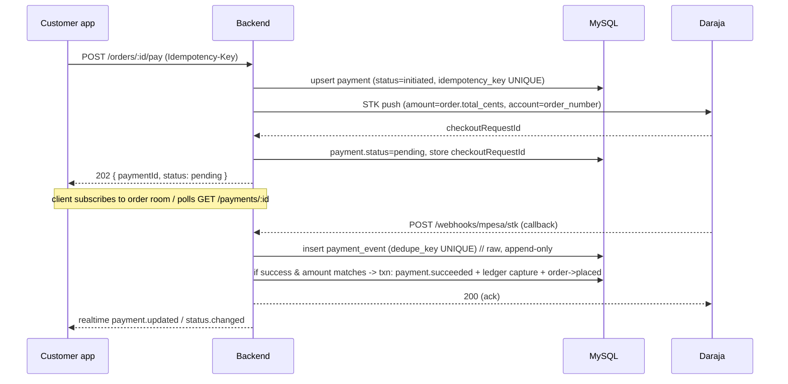

# 07 — Payment Processing & Reconciliation

> Status: DRAFT for review. Payments are **simulated** until production Daraja credentials are
> configured; the simulation path and the real path share the same state transitions, ledger
> writes, and idempotency guards so switching providers changes only the adapter.

## 1. Principles

- **The server decides what is paid.** An order is `paid` only after a verified Daraja
  success callback whose amount matches the order total. Clients never set payment status.
- **Idempotent everywhere.** Initiation, callbacks, status queries, and refunds are all safe
  to retry and safe to receive in duplicate.
- **Every money movement is a balanced ledger transaction** written in the same DB
  transaction as the state change.
- **No money event is ever lost.** Raw callbacks are persisted before processing; a
  reconciliation job repairs any divergence between Daraja and our records.

## 2. Payment provider abstraction

```
PaymentGateway (interface)
  initiateStkPush(order, phone, idempotencyKey) -> { checkoutRequestId }
  queryStkStatus(checkoutRequestId) -> result
  initiateB2CPayout(payout) -> { conversationId }     // settlements/rider payouts
Implementations:
  - DarajaGateway   (sandbox / production)
  - SimulatedGateway (local/staging; deterministic success/fail/timeout)
```

The active gateway is chosen by env (`PAYMENT_PROVIDER=simulated|daraja_sandbox|daraja_prod`).

## 3. STK push flow (customer pays)



### Correlation & verification
- STK push carries the `order_number` as the account reference and the exact
  `order.total_cents` as amount.
- Callback is matched by `checkout_request_id`. We **verify the amount** equals the payment's
  expected amount before marking success; mismatches are quarantined for ops, never
  auto-captured.
- Callback source authenticity: validate via allow-listed source + shared secret/path token,
  and (production) confirm by an independent `queryStkStatus` before final capture for
  high-value orders. (Daraja does not sign callbacks, so we treat callbacks as *hints* and
  confirm via status query / reconciliation.)

## 4. Duplicate callback handling

- `payment_event.dedupe_key` (e.g. `checkout_request_id + ':' + result_code`) is **UNIQUE**:
  a duplicate insert fails and the handler returns `200` without reprocessing.
- The capture ledger transaction uses `ledger_transaction.idempotency_key =
  'order_capture:' + payment.id`: a second capture attempt is a no-op.
- `payment.mpesa_receipt` is **UNIQUE**: the same receipt can never credit twice.
- Net effect: receiving the same callback N times produces exactly one capture.

## 5. Timeouts & late callbacks

| Scenario | Handling |
|----------|----------|
| No callback within STK wait window (**2 min, configurable — D10**) | Job runs `queryStkStatus`. Success → capture (as if callback). Still pending → keep `pending` and retry query with backoff. Failure → `payment_failed`. A timeout must **never** silently produce an unpaid-but-dispatchable order. |
| Local `payment_failed` then late success callback arrives | Idempotent capture reconciles payment to `succeeded`. If order was cancelled meanwhile → trigger **auto-refund**. |
| Daraja unreachable at initiation | Return a retryable error; the `initiated` payment is cleaned up / reused via idempotency key. |
| Customer closes app mid-flow | Payment resolves server-side regardless; customer sees final state on next fetch / notification. |

## 6. Reconciliation (daily + on-demand)

A scheduled job (BullMQ) reconciles our records against Daraja:
1. For every `payment` in a non-terminal state older than threshold → `queryStkStatus` and
   resolve.
2. Compare captured `payment`/`ledger` against Daraja transaction statements (C2B/STK results
   and, later, settlement statements).
3. Produce a **reconciliation report**: matched, missing-local (money in Daraja, not captured
   locally), missing-remote (captured locally, not in Daraja), amount-mismatch.
4. Anything unmatched is surfaced in the admin reconciliation view with **no automatic money
   movement**; ops/finance resolve with audited adjustments.

Ledger invariant check runs alongside: for every `ledger_transaction`,
`sum(debits) == sum(credits)`; any imbalance pages on-call.

## 7. Double-entry ledger (capture → settlement → payout)

Representative accounts: `mpesa_clearing` (asset), `platform_cash` (asset),
`merchant_payable:{id}` (liability), `rider_payable:{id}` (liability),
`commission_revenue` (revenue), `promo_expense` (expense), `refunds_payable` (liability).

**On order capture** (total = subtotal + delivery_fee + service_fee − discount):
```
DR mpesa_clearing              total
  CR merchant_payable:{m}        subtotal - commission
  CR commission_revenue          commission
  CR rider_payable (accrued at delivery, or platform_delivery_income)  delivery_fee
  CR promo_expense (contra)      discount      // funded by platform
```
(Exact split depends on who funds promotions and delivery — see doc 12.) Rider earnings are
**accrued on `delivered`**, moving the delivery fee portion to `rider_payable`.

**On refund:** reverse the relevant entries into `refunds_payable`, then settle the refund
outflow when executed.

**On settlement/payout:** debit the payable, credit cash/clearing when the B2C payout
completes (idempotent via `payout.idempotency_key` and B2C callback dedupe).

## 8. Refunds

- Triggered by: merchant reject, pre-accept cancel, ops cancel, or approved customer dispute.
- Full or partial; amount validated `<= net refundable` for the order.
- `refund.idempotency_key` UNIQUE prevents double refunds.
- Refund execution via Daraja reversal/B2C depending on policy; until prod, simulated.
- State: `requested → approved → processing → completed` with ledger reversal on completion;
  `refunded`/`partially_refunded` reflected on the order.
- Separation of duties: requester ≠ approver for manual refunds (doc 06).
- **A refund is never marked `completed` until the provider confirms it (D6).** We do not
  promise instant refunds; `processing → completed` is driven by a confirmed provider result
  or reconciliation, preserving the full audit trail even for late/ambiguous outcomes.

## 9. Simulation mode (pre-production)

- `SimulatedGateway` returns deterministic outcomes and can drive callbacks via
  `POST /dev/payments/:id/simulate { success|fail|timeout }` (admin, non-prod only).
- Lets us build and test the **entire** capture/refund/settlement/payout + reconciliation
  machinery before real credentials exist. Switching to Daraja is an adapter swap.

## 10. Payouts (merchant settlements & rider earnings)

- Settlements aggregate delivered, non-refunded orders per merchant per period →
  `settlement` + `settlement_line`; net = gross − commission − refunds.
- Rider earnings aggregate delivered `delivery.rider_fee_cents` per period.
- Payout batches are **drafted → approved (finance) → executed (B2C)**, each step audited and
  idempotent; failures are retryable without double-paying.

> **Cash-flow dependency (E9).** Refunds and merchant/rider payouts depend on realized
> platform cash; we do not assume sufficient float exists to pre-fund them. Settlement and
> payout cadence (D13) must be reconciled against actual collected funds, and the ledger —
> not any mutable balance field — is the source of financial truth (E8).

## 11. Acceptance criteria

- [ ] Replaying the same STK callback 100× yields exactly one capture and one ledger txn.
- [ ] Amount-mismatch callback is quarantined, never auto-captured.
- [ ] Simulated timeout → reconciliation query resolves state deterministically.
- [ ] Late-success-after-cancel path produces an auto-refund.
- [ ] Ledger balances (debits == credits) across a full simulated order→refund→settlement→payout.
- [ ] Refund idempotency: duplicate approve/execute never double-pays.
- [ ] Switching `PAYMENT_PROVIDER` requires no changes outside the gateway adapter.
