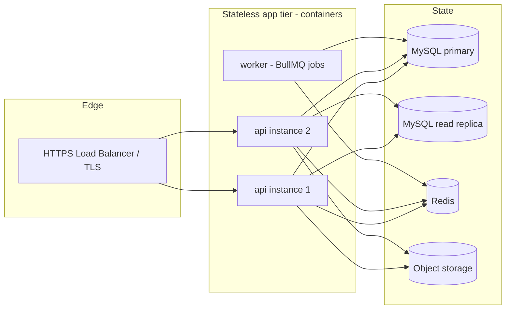

# 10 — Deployment & Disaster Recovery

> Status: DRAFT for review. Specific cloud/provider is an open decision (doc 12); this
> document specifies requirements and a reference topology that works on common providers.

## 1. Environments

| Env | Purpose | Payments | Data |
|-----|---------|----------|------|
| `local` | Developer machines | SimulatedGateway + mock-daraja | synthetic (docker-compose) |
| `staging` | Pre-prod, integration, UAT | Daraja **sandbox** | synthetic |
| `production` | Live (single region at launch) | Daraja **production** | real (protected) |

Config via `packages/config` with a **zod-validated env schema**; the service refuses to boot
with missing/invalid configuration. Secrets come from a secret manager, never the repo.

## 2. Reference topology (launch, single region)



- **App tier is stateless** → horizontal scale behind the LB; sessions are JWT-based.
- **Workers** run scheduled/async jobs (timeouts, reconciliation, settlements, payouts,
  notifications) separately from request-serving instances.
- Socket.IO scales via a **Redis adapter** for multi-instance pub/sub.
- Managed MySQL (primary + replica) and managed Redis strongly preferred to offload HA/backup
  operations.

## 3. Containerization & delivery

- Each app has a multi-stage Dockerfile; images built in CI, tagged by commit SHA.
- `infra/` holds docker-compose (local) and production manifests (Compose/Kubernetes/provider
  equivalent — see open decision).
- Mobile apps ship via Expo EAS build/submit channels (staging vs. production).

## 4. CI/CD pipeline

```
PR:      install → typecheck → lint → unit+integration+contract tests → build → security scan
Merge to main:   build images → push → deploy to staging → smoke tests → manual gate
Release:         tag → deploy to production (rolling) → post-deploy health & smoke checks
```
- **Database migrations** run as an explicit, ordered step **before** app rollout, using
  forward-only, backward-compatible migrations (expand/contract pattern) so old and new app
  versions can briefly coexist during a rolling deploy.
- Rollback: redeploy previous image; destructive migrations are split (expand now, contract
  in a later release) so rollback never requires undoing data loss.

## 5. Database migrations policy

- Versioned SQL migrations in `db/migrations` are the **source of truth** (CLAUDE.md:
  documented migrations). Every migration has a reviewed `up` and, where feasible, `down`.
- **Expand/contract**: add columns/tables → backfill → switch reads/writes → remove old
  (separate release). Never rename/drop in the same deploy that stops using them.
- Migrations are tested in CI (apply to a fresh DB + apply on top of a restored
  production-shaped snapshot in staging).
- No ad-hoc production schema changes; all changes go through migrations + review.

## 6. Backups

| Aspect | Policy (proposed) |
|--------|-------------------|
| Full backup | Daily automated snapshot of MySQL, retained ≥ 30 days |
| Point-in-time | Binlog/transaction-log retention for PITR (target window ≥ 7 days) |
| Object storage | Versioning + lifecycle retention for KYC/images/proofs |
| Encryption | At rest (storage-level) + TLS in transit |
| Offsite | Backups replicated to a second location/region |
| Verification | **Automated monthly restore drill** into an isolated environment + integrity checks |

**Financial/legal records** (payments, ledger, settlements, payouts, audit) have extended
retention per Kenyan statutory/tax requirements (confirm exact period with Finance/Legal).

## 7. Disaster recovery

- **RPO / RTO targets (proposed, to confirm):** RPO ≤ 15 min (PITR), RTO ≤ 2 hours for the
  order/payment path at launch.
- **Scenarios & responses:**
  - *App instance failure* → LB reroutes; auto-replace.
  - *MySQL primary failure* → promote replica (managed failover); app reconnects.
  - *Redis loss* → ephemeral data (offers, locks, cache) rebuilt; **money/order truth is in
    MySQL**, so no financial loss. In-flight offers re-derived; reconciliation reconciles
    payments.
  - *Region outage* → restore from offsite backup into standby region (RTO-bounded);
    documented runbook.
  - *Bad deploy/migration* → rollback image; expand/contract ensures data safety.
- **Reconciliation is the financial safety net**: even after an incident, the Daraja-vs-ledger
  reconciliation job detects and surfaces any divergence rather than silently losing money.

## 8. Observability & on-call

- Structured JSON logs with `X-Request-Id`; centralized log aggregation.
- Metrics: payment funnel (initiated/pending/succeeded/failed), reconciliation mismatch count,
  order-state SLA breaches, assignment success/latency, queue depth, DB/Redis health.
- Alerts page on-call for: ledger imbalance, reconciliation mismatches above threshold,
  payment success-rate drop, migration failure, backup/restore-drill failure.
- Runbooks in `docs/` for: failed payout, stuck payment, reconciliation mismatch, restore,
  rider-assignment stall.

## 9. Secrets & access

- Secret manager for Daraja keys, DB creds, signing keys, SMS/maps keys; rotation supported.
- Least-privilege DB roles: the app role has **no DELETE/UPDATE on `audit_log`** and limited
  DDL; migrations run under a separate role.
- Production access is role-gated, MFA-protected, and audited.

## 10. Acceptance criteria

- [ ] One-command local stack; staging mirrors prod topology with sandbox Daraja.
- [ ] Migrations run as a gated pre-deploy step; rollback procedure documented and rehearsed.
- [ ] Automated backup configured; **a restore drill has actually been performed and its
      result recorded** (not merely configured).
- [ ] Documented RPO/RTO with a tested region-restore runbook.
- [ ] Alerting verified for ledger imbalance and reconciliation mismatch.
